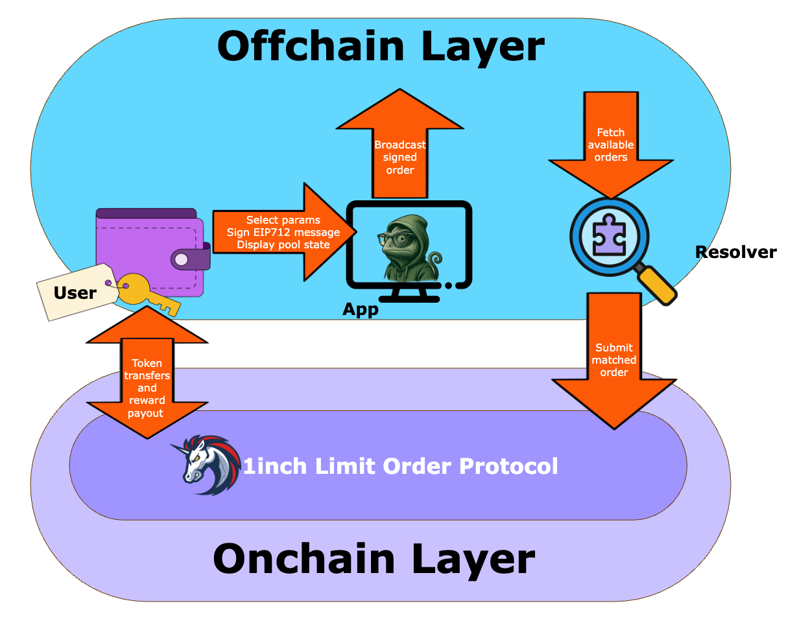
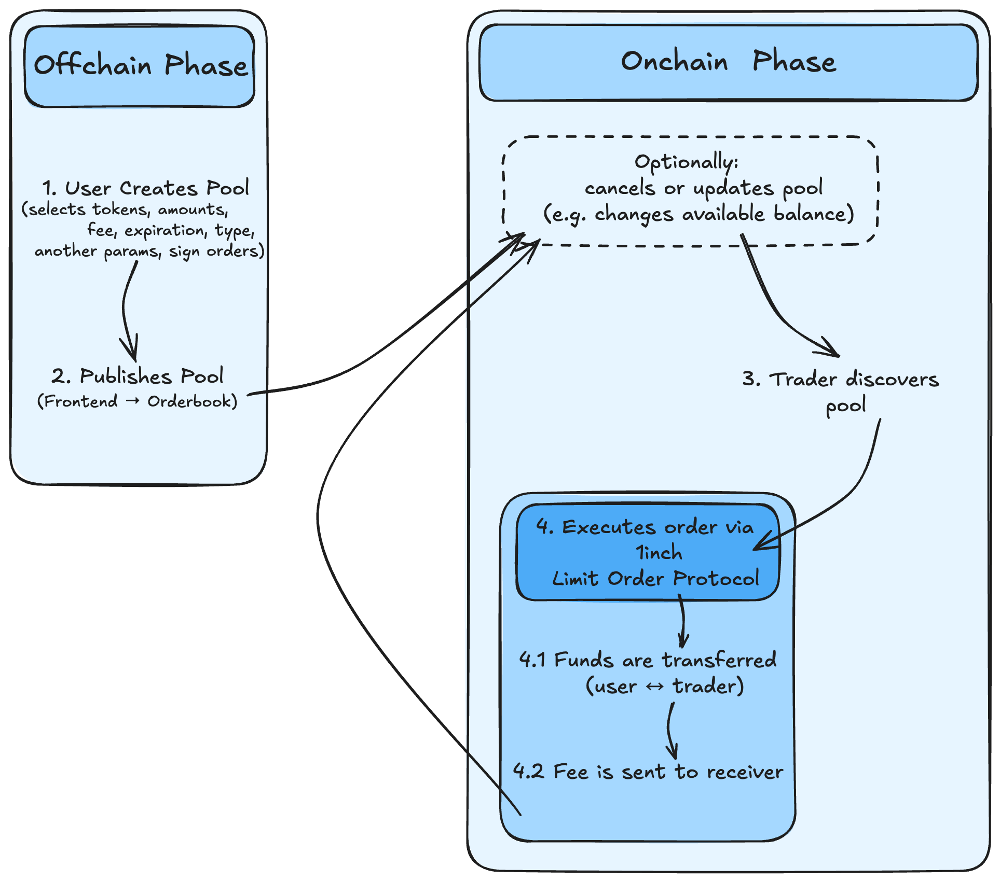

    

# Lopswap: Offchain Liquidity Layer

---

## Overview
Lopswap is an **offchain, non-custodial liquidity layer** built on top of the 1inch Limit Order Protocol.
Liquidity always stays in the user’s wallet until the moment of execution, enabling **instant yield, zero lockups, and maximum capital efficiency**.
Users define pools offchain via signed EIP-712 messages, which are executed onchain only when matched — with full flexibility, revocability, and composability.

---

## Disclaimer

Nothing in this repository or its accompanying documentation constitutes financial or investment advice, an investment recommendation, or a recommendation of any trading or investment strategy. Users are solely responsible for evaluating the risks associated with using the protocol.

---

## ELI5
- **Traditional DeFi protocols**: you deposit tokens into a contract → tokens are locked, you lose flexibility, and take on protocol risk.
- **Lopswap**: your tokens stay in your wallet → they can work across multiple pools at once and remain under your control until the exact moment of execution.

---

## Key Features
- 🔑 **Non-custodial** — assets never leave your wallet until execution.
- ⚡ **Gasless until execution** — pools are created offchain via EIP-712.
- ♻️ **Capital reuse** — the same tokens can participate in multiple pools simultaneously.
- 🎯 **Programmable liquidity** — pools can include traits such as time locks, price bounds, or whitelisted takers.
- 🌐 **Multi-chain ready** — compatible with all EVM networks supported by 1inch LOP.
- ✅ Audited — full report available in [Security](#security) section.

---

## Architecture

The protocol separates liquidity declaration, discovery, and execution into distinct layers:
- **User Wallet** — signs EIP-712 orders, funds remain self-custodied.
- **Offchain Layer** — pools are broadcast and discovered without gas costs.
- **Resolvers** — find and submit matched orders.
- **Onchain Execution** — settlement via 1inch Limit Order Protocol.

---

## Competitive Advantages

| Feature              | **Lopswap**            | AMMs / Vaults      |
|----------------------|------------------------|--------------------|
| **Custody**          | Wallet-native          | Contract-based     |
| **Capital Reuse**    | ✅ Yes                 | ❌ No              |
| **Pool Creation Cost** | 0 (offchain)          | High (onchain)     |
| **Flexibility**      | High                   | Medium             |
| **Yield**            | Instant on execution   | Delayed or claim-based |

---

## Security
- ✅ Independent security audit by Pessimistic — [View Report](https://github.com/pessimistic-io/audits/blob/f3611c6a06356f447f931d10e4110953a855c667/Lopswap%20Security%20Analysis%20by%20Pessimistic.pdf)
- 🔒 Non-custodial by design: assets never locked in contracts.
- ✍️ Proven security: pools use EIP-712 signatures and settle via the battle-tested 1inch Limit Order Protocol.
- 🛑 Revocable orders: users can cancel, modify, or move funds anytime.
- 🔐 Standard approvals: execution requires only a token approve (or permit/Permit2) to the official 1inch LOP contract.

---

## Developer Notes ⚠️

- **Maker-controlled pools** — liquidity providers may update or invalidate pools using `setLiquidity` or `invalidatePool`.
- **Orders may also be cancelled directly through the 1inch Limit Order Protocol** — this is not reflected in `poolStatus`. Depending on the cancellation method, one, several, or all orders may become unfillable. If only some are cancelled, a multi-order pool remains partially operational. Conversely, `invalidatePool` invalidates all orders belonging to the LopSwap pool in a single transaction. Resolvers must verify each order’s state in LOP before filling.
- **Takers MUST use slippage protection** — otherwise a transaction may revert or execute at an unfavorable rate.
- Always validate balances, allowances, and expiration before attempting a fill.

---

## Documentation
- 📄 [Whitepaper v0.4](./docs/Lopswap_White_Paper_v0.4.pdf)
- 🛡️ [Audit Report by Pessimistic](https://github.com/pessimistic-io/audits/blob/f3611c6a06356f447f931d10e4110953a855c667/Lopswap%20Security%20Analysis%20by%20Pessimistic.pdf)
- 📚 [Smart Contract Docs](./docs)
